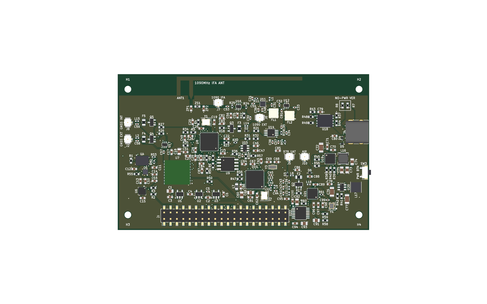
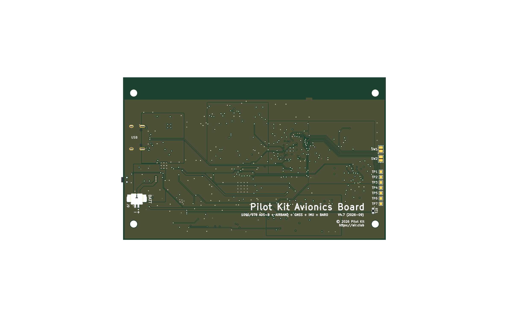

# Pilot Kit Avionics Board V4.7

**Integrated ADS-B / GNSS / IMU expansion board for the Pilot Kit Box**
集成 ADS-B / GNSS / IMU 扩展板

  

A 6-layer, 100.1 × 62.1 mm HAT that stacks onto the Waveshare
ESP32-P4-WIFI6-Touch-LCD-4.3 carrier's 2×20 header. It replaces the four
discrete modules used by the current prototype (RTL-SDR dongle, BNO085,
GT-U8 GNSS, BMP388) with a single board — **including its own 1090 MHz
receive chain, so no RTL-SDR dongle is required.**

6 层、100.1 × 62.1 mm，以 HAT 方式直插微雪 ESP32-P4-WIFI6-Touch-LCD-4.3
载板的 2×20 排母，把现有原型的四个分立模块（RTL-SDR dongle、BNO085、
GT-U8 GNSS、BMP388）整合成一块板，**自带 1090 MHz 接收链，不再需要 dongle**。

---

## ⚠️ Status / 当前状态

> **V4.0 has been fabricated; V4.7 is the current manufacturing revision.**
> V4.7 adds a hardware power button (`SW3` on the SY6970 `/QON` pin — V4.6 and
> earlier had no way to switch the box off or hard-reset it) and the airband
> reference-clock DC-block (`C99` + `R61`). V4.6 added the 118–137 MHz airband
> receive chain (BK4819 + 26 MHz TCXO + PCM1808 I²S capture, stage G of the
> assembly list). V4.5 carried forward the
> V4.3 electrical corrections and the V4.0 measured 50.0mm IFA geometry, and
> fixed GNSS active-antenna detection: the module's `VCC_RF` (U7.14) now feeds
> the two bias-tee PMOS sources instead of being left unconnected, so `$GPTXT`
> can report `ANTENNA OK/OPEN/SHORT`. V4.7 passes every automated check below
> (ERC 0 violations, DRC 0 violations / 0 unconnected, zone fills current), but
> no revision after V4.0 has been fabricated — the airband chain and the power
> button have never been powered up. Owners of V4.0 boards must follow the
> internal rework record before powering the 1090 MHz chain.
>
> **V4.0 已经打样；V4.7 是当前制造版本。** V4.7 = V4.6 + 硬件电源键
> （`SW3` 接 SY6970 的 `/QON` —— V4.6 及以前整机关不掉、也不能硬复位）
> + 航空波段参考时钟的隔直（`C99` + `R61`）。V4.6 = V4.5 + 118–137MHz 航空波段接收
> （BK4819 + 26MHz TCXO + PCM1808 I²S 采集，对应贴片清单阶段 G）。V4.5 继承 V4.3 的
> 电气修正和 V4.0 逐刀实测定型的 50.0mm IFA 几何，并修复 GNSS 有源天线检测：模块
> `VCC_RF`(U7.14) 不再悬空，改为两路偏置 Tee PMOS 的源极电源，模块据此才能输出
> `ANTENNA OK/OPEN/SHORT`。V4.7 通过了下列全部自动检查（ERC 0 违规、DRC 0 违例 / 0 未连通、
> 覆铜填充为最新），但 V4.0 之后各版均未打样 —— 航空波段和电源键都还没上过电。
> V4.0 实物在开启 1090 MHz 链路前必须先按内部返修记录处理。

| | Status / 状态 |
|---|---|
| Schematic / 原理图 | ✅ Complete / 完成 |
| Layout & routing / 布局布线 | ✅ Complete — 0 DRC violations, 0 unconnected nets / 零违例、未连通 0 |
| Manufacturing files / 制造文件 | ✅ Gerber + drill export cleanly / 可正常导出 |
| **Fabrication / 打样** | ⚠️ V4.0 fabricated; V4.7 not yet fabricated / V4.0 已打样，V4.7 待打样 |
| **Bring-up / 上电验证** | ⚠️ V4.0 rework procedure prepared; V4.7 pending / V4.0 返修流程已就绪，V4.7 待验证 |
| **Airband RX / 航空波段接收** | ⚠️ New in V4.6, never fabricated or bench-tested / V4.6 新增，未打样未台架验证 |
| **Power button / 电源键** | ⚠️ New in V4.7 (`SW3` → SY6970 `/QON`), never tested / V4.7 新增（`SW3` 接 SY6970 `/QON`），未验证 |
| **On-board IFA antenna / 板载 IFA 天线** | ✅ V4.0 per-cut measured 50.0mm geometry transferred / V4.0 逐刀实测 50.0mm 几何已回灌 |

**About the IFA antenna** — V4.7 keeps the V4.0 physical-board result: a
**50.0mm copper outer envelope** (48.5mm radiating-arm centerline span), with
the matching network straight-through (`ZS1`=0R, `ZP1`/`ZP2`=DNP). The V4.0
board was trimmed cut-by-cut from 53.5mm and stopped at 50.0mm, where it
measured **1082.5MHz, SWR 1.09, 45+j0.5Ω** in the case with the battery
fitted. The same series yields a slope of **24–25 MHz/mm**. These values
validate the transferred geometry, but each new enclosure/material batch
still needs a VNA spot check. See [`BOM_IFA_TUNING.md`](BOM_IFA_TUNING.md).

板载 1090MHz 倒 F 天线采用 V4.0 实板逐刀定型结果：**铜箔外包络 50.0mm**（辐射臂
中心线跨度 48.5mm），匹配网络直通（`ZS1`=0R、`ZP1`/`ZP2`=DNP）。该板由 53.5mm
逐刀切短并在 50.0mm 停刀，装盒且装电池实测 **1082.5MHz、SWR 1.09、45+j0.5Ω**；
同一组序列给出斜率 **24–25MHz/mm**。
该结果已回灌至 V4.7，但新外壳或板材批次仍应抽样用 VNA 复核。

---

## Specifications / 规格

| | |
|---|---|
| **Outline / Layers** | 100.1 × 62.1 mm, 6 layers |
| **Stackup** | Designed for 0.0994 mm L1→In1 (single-ply 3313); any 0.085–0.115 mm works as-is — see below |
| **Layer usage** | F.Cu signal · In1 solid GND (RF reference) · In2 signal · In3 3V3 plane · In4 solid GND · B.Cu signal |
| **1090 MHz RX** | QPL9547 LNA → TA0970A SAW → BGA2817 → AD8313 log detector → TLV3501 comparator → RP2040 PIO decoder |
| **978 MHz UAT** | CC1312R1F3RGZR sub-GHz transceiver, differential LC match |
| **118–137 MHz airband RX** | BK4819 AM receiver (26 MHz TCXO reference) → PCM1808 24-bit I²S capture → P4's second I²S. Receive only: `PAOUT`/`VRAMP` unconnected, no PA |
| **Antennas** | On-board 1090 IFA + 4 external U.FL (1090 ext `J6` / 978 `J5` / GNSS ext `J2` / airband `J10`), PMOS-switched bias tees; plus `J8` to the internal GNSS patch and `J7` IFA test port |
| **GNSS** | ATGM336H-6N-74, switchable internal patch / external antenna; module `VCC_RF` (U7.14) feeds the bias tees for active-antenna detection |
| **Sensors** | BNO085 IMU (100 Hz fusion), BMP388 barometer, QMC5883P magnetometer |
| **Power** (optional) | CH224K USB-PD sink @9 V → SY6970 charger + fuel gauge → SY7069 5 V boost, single-cell Li-po |
| **Host interface** | 2×20 SMD header, HAT-style stacking onto the carrier |
| **Scale** | 207 placements (229 designators, 22 not placed), 475 vias (all 0.30 mm drill / 0.45 mm pad), 1784 track segments |

Two assembly variants — with and without the on-board power section.
See [`VARIANTS.md`](VARIANTS.md).
两个装配变体（带/不带板载电源），选贴规则见该文档。

  

---

## Documentation / 文档

Every board document ships in two languages: the English original
(`*.md`) and the Simplified-Chinese working notes (`*-zh_CN.md`) it was
authored in. Tables, part numbers, and net names are identical in both.

| Document | Contents | Lang |
|---|---|---|
| [`PINMAP.md`](PINMAP.md) | Authoritative pin and net map — the single source of truth for the schematic | EN / 中文 |
| [`VARIANTS.md`](VARIANTS.md) | Powered vs. unpowered assembly variants (inverted logic — read before ordering) | EN / 中文 |
| [`ASSEMBLY.md`](ASSEMBLY.md) | Hand-assembly placement list, generated from the board | EN / 中文 |
| [`ASSEMBLY_MAP-V4.7.pdf`](ASSEMBLY_MAP-V4.7.pdf) / [`ASSEMBLY_MAP-V4.7-zh_CN.pdf`](ASSEMBLY_MAP-V4.7-zh_CN.pdf) | Color-coded full-board assembly maps (placement semantics, three pages each) | PDF |
| [`SELECTIVE_PLACEMENT.md`](SELECTIVE_PLACEMENT.md) | Selective-placement groups and **mutex rules** — which parts must never be populated together | EN / 中文 |
| [`CHECKLIST.md`](CHECKLIST.md) | Per-reference BOM checklist for hand placement (also [.xlsx](CHECKLIST-V4.7.xlsx) / [.pdf](CHECKLIST-V4.7.pdf)) | EN / 中文 |
| [`BOM_PURCHASE-zh_CN.md`](BOM_PURCHASE-zh_CN.md) | Authoritative purchasing list, generated from the netlist | 中文 |
| [`BOM_IFA_TUNING.md`](BOM_IFA_TUNING.md) | Antenna tuning kit and the VNA procedure | EN / 中文 |
| [`BASEBOARD_REF.md`](BASEBOARD_REF.md) | Mechanical reference for the Waveshare carrier | EN / 中文 |

---

## Manufacturing package / 制造包

Pre-built packages live in [`release/`](release/):

**The working PCB has changed since the V4.7 archive below. Finalize and verify the design, then regenerate the manufacturing package before ordering. The existing V4.7 archive does not represent the current working PCB.**

| File | Use |
|---|---|
| `expansion-board-v4-gerber-JLC-V4.7-20260913.zip` | Latest archived V4.7 export — includes `SW3` and `C99`/`R61`, RS-274-X, 15 files. **Working PCB has changed; regenerate before ordering** |
| `expansion-board-v4-kicad-V4.7-20260913.zip` | Source matching the archived export, **not the current working PCB**. Not accepted by the fab |
| `expansion-board-v4-gerber-JLC-V4.6-20260911.zip` | ⚠️ Superseded by V4.7 — no power button (the box cannot be switched off or hard-reset) and the TCXO output is DC-coupled straight into BK4819 `XI`. Do not order |
| `expansion-board-v4-kicad-V4.6-20260911.zip` | ⚠️ Matching superseded V4.6 source archive |
| `expansion-board-v4-gerber-JLC-V4.5-20260911.zip` | ⚠️ Superseded — same board without the airband chain. Do not order |
| `expansion-board-v4-kicad-V4.5-20260911.zip` | ⚠️ Matching superseded V4.5 source archive |
| `expansion-board-v4-gerber-JLC-V4.4-20260904.zip` | ⚠️ Superseded by V4.5 — V4.4 did not wire U7.14 (VCC_RF), so the module always reported `ANTENNA OPEN`. Do not order |
| `expansion-board-v4-kicad-V4.4-20260904.zip` | ⚠️ Matching superseded V4.4 source archive — do not use |
| `expansion-board-v4-gerber-JLC-V4.3-20260902.zip` | ⚠️ Superseded by V4.4 before fabrication — old 53.5mm IFA outer envelope, do not order |
| `expansion-board-v4-kicad-V4.3-20260902.zip` | ⚠️ Matching superseded V4.3 source archive — do not use |
| `expansion-board-v4-gerber-JLC-V4.1-20260830.zip` | ⚠️ Superseded before the QPL9547 bias and power corrections — do not order |
| `expansion-board-v4-kicad-V4.1-20260830.zip` | ⚠️ Matching superseded V4.1 source archive — do not use |
| `expansion-board-v4-gerber-JLC-20260830.zip` | ⚠️ Superseded: electrically includes the ECO but carries the stale V4.0 silkscreen — do not order |
| `expansion-board-v4-kicad-20260830.zip` | ⚠️ Matching stale-V4.0 source archive — do not use as the release source |
| `expansion-board-v4-gerber-JLC-20260828.zip` | ⚠️ Superseded baseline — do not use for a new order. The GNSS antenna/bias topology itself was later verified correct and was not rewired |
| `expansion-board-v4-gerber-20260828.zip` | ⚠️ Older export in Gerber **X2** format — do not use |

### Airband reference clock — fixed in V4.7, read this before you bench it

`Y4` (26 MHz TCXO) feeds the `XI` pin of `U21` (BK4819) through `C99` (100 pF
DC-block) with `R61` (10 kΩ) as the load; the net is split into `VHF_TCXO_OUT`
on the oscillator side and `VHF_TCXO` on the `XI` side. **In V4.6 and earlier
the two pads were connected directly** — the TCXO datasheet specifies its output
only under a 10 kΩ // 10 pF load *through a DC-block capacitor*, and BK4819's
`XI` is a parallel-resonant crystal-oscillator input that self-biases, so
DC-coupling them was outside both parts' specified conditions and could have
left the 26 MHz reference dead. That is why V4.6 is marked superseded above.

One thing to measure on the first article: `Y4`'s rated supply is
**2.85 / 3.0 / 3.15 V** while the board feeds it 3.3 V from `3V3_RF`. The part is
fine on frequency — ±2.0 ppm at 25 °C plus ±0.5 ppm over temperature, both inside
the ±2.5 ppm BK4819 asks for — and 3.3 V sits inside the family's 1.7–3.465 V
range, so nothing is damaged. What 3.3 V costs is only that the frequency figures
are no longer *guaranteed* (`f0-Vcc` is ±0.2 ppm per ±5 % of Vcc, so the expected
error is well under 1 ppm). Worth one frequency-offset measurement; not a reason
to change the part. The datasheet-value equivalent `TG2520SMN` is **not** a valid
substitute — Epson's own parametric data flags it as having a frequency-control
pin, which would make `Y4.1` a control input rather than the N.C. this circuit
leaves floating.

### ⚠️ Three things that will ruin the board if set wrong

1. **Gerbers must be RS-274-X, not X2.** JLCPCB accepts neither KiCad project
   files nor Gerber X2. KiCad exports X2 by default, so the release package is
   regenerated with `--no-x2 --no-netlist`.
2. **Via solder-mask state comes from the file, not the order form.** JLCPCB,
   HQPCB and JiePei all state the same thing: *"if the file is Gerber, we
   process strictly per the file; this option has no effect"* — Gerber cannot
   tell a via from a component hole. This board ships 475 vias: 396 tented,
   79 exposed (all 79 inside pad mask openings, 33 of them thermal via-in-pad).
   `internal/tools/gerber.sh` recomputes this split on every release — never
   copy the numbers from an older revision.
3. **`J4`'s four `SH` holes must NOT be resin-plugged.** They are ⌀0.60 mm
   plated *slots* (Excellon `G85`) that mechanically anchor the USB-C
   receptacle. Plug them and the connector will tear off after a few
   insertions. If you order resin-filled via-in-pad, exclude these explicitly
   in the order notes.

### Stackup: preferred, not mandatory

The 28 controlled-impedance RF nets are 0.15 mm wide, derived from an L1→In1
dielectric of **0.0994 mm (single-ply 3313 prepreg)**. You do **not** need that
exact stackup:

| Your fab's L1→In1 | Result | Action |
|---|---|---|
| **0.085 – 0.115 mm** | 45–55 Ω | Send as-is. Verified: JLCPCB `JLC06161H-3313`, JiePei `JP06161H-3313B2` |
| ~0.125 mm (single-ply 2116) | ≈57 Ω | Still fine — 0.02 dB mismatch loss |
| ~0.19 mm (single-ply 7628) | ≈70 Ω | Buildable — 0.12 dB mismatch loss, slightly lower 1090 sensitivity |

The longest RF run is 11.7 mm ≈ λ/13 at 1090 MHz, so mismatch never builds a
standing wave — every case above costs less than the 0.51 dB that an SWR of 2.0
would.

> 🔴 **The on-board IFA antenna, however, does need retuning for your laminate.**
> The 50.0 mm copper length is tied to JLCPCB's 3313 material. Measured on
> 2026-09-11: the same Gerber built by JiePei on `JP06161H-7628A1` resonated at
> **1062.5 MHz instead of 1085 MHz**, with SWR rising from 1.06 to 1.72 — the
> laminate's εr sets antenna resonance, and clearing all six copper layers removes
> the *copper*, not the 1.6 mm of FR-4 underneath. Trim 0.1–0.2 mm at a time using
> 11.5 MHz/mm as the slope, and judge in the enclosure. Irrelevant if you only use
> the external U.FL/SMA antenna.

Full numbers, per-vendor stackup tables and the mismatch-loss derivation:
[`PCB_STACKUP_IMPEDANCE.md`](../PCB_STACKUP_IMPEDANCE.md).

---

## What ships here / 这里交付什么

This directory carries the **results**: the KiCad project, the fabrication
package, and the assembly documents. Open `kicad/` in KiCad 10 to inspect or
modify the design; send `release/` straight to a board house.

本目录交付的是**结果**：KiCad 工程、制造文件包、装配文档。
要看或改设计，用 KiCad 10 打开 `kicad/`；要打板，把 `release/` 直接发板厂。

| Path | What it is |
|---|---|
| `kicad/` | Schematic + PCB source, openable and editable in KiCad 10 |
| `release/` | Gerber, drill, BOM and CPL — ready to send to a fab |
| `ASSEMBLY_MAP-V4.7.pdf` | Per-designator placement map with orientation and polarity |
| `CHECKLIST.md` | Line-by-line check sheet for hand assembly |
| `SELECTIVE_PLACEMENT.md` | Which designators must **not** simply be populated from the BOM |
| `BOM_PURCHASE-zh_CN.md` | Parts list with values, packages and selection constraints |

The board was generated and verified by an internal script chain rather than
hand-maintained, which is why the schematic, placement, routing, zones and
silkscreen are all internally consistent. Those generators are part of our
build process, not part of what this board is — they are not published.

板子由内部脚本链生成和校验，不是手工维护的，所以原理图、布局、布线、覆铜
和丝印彼此严格一致。那套生成器属于我们的构建过程，不是这块板本身，
因此不在公开范围内。

Requires KiCad 10 to open the project (it uses KiCad 10 file formats).
打开工程需要 KiCad 10（文件格式为 KiCad 10）。

---

## License / 许可

MIT, same as the parent repository — see the
[main README](../../README.md#开源协议--license).
与主仓库一致（MIT）。

The KiCad project embeds footprints from the KiCad standard libraries, which
are CC-BY-SA 4.0 with an exception explicitly permitting unrestricted use of
boards produced from them — so this does not impose copyleft on your hardware.
本工程内嵌了 KiCad 官方库的封装（CC-BY-SA 4.0，但其例外条款明确允许
由此制造的板子不受限制使用，不会传染到你的硬件）。
